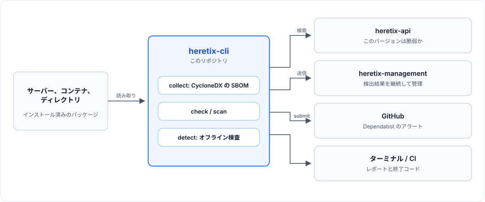

# heretix-cli

heretix-cli は、**[heretix](https://titeee.github.io/heretix-web/)** のスキャナーです。heretix は、サーバー・コンテナ・ネットワーク機器（ファイアウォール、VPN など）の CVE を 1 つのインベントリで管理する、セルフホスト型のツール群です（Apache-2.0）。

[English README](README.md)

## 概要

サーバー上で実行するか、コンテナイメージやディレクトリを指定して実行します。インストールされているパッケージを洗い出し、そのうちどれに脆弱性があるかを [heretix-api](https://github.com/TITeee/heretix-api) に問い合わせます。

```
$ heretix-cli scan --image myapp:latest
   ECOSYSTEM   PACKAGE               VERSION    SOURCE               DB    VULN ID               CVSS   EPSS  SUMMARY
!  AlmaLinux   curl                  7.88.1     rpm                  nvd   CVE-2024-1234          9.8  0.950  Remote code exec
   PyPI        requests              2.31.0     /srv/myapp/requir... osv   GHSA-xxxx-yyyy         6.1  0.045  SSRF via proxy
 B Debian      binutils(2 pkgs)      2.44-3     dpkg                 osv   CVE-2024-9999          5.5  0.002  Heap overflow in BFD
...
Summary: 14 packages with 21 findings (1 malware, 1 KEV)
```



- **heretix-cli**（このリポジトリ）: パッケージを洗い出し、CycloneDX の SBOM として書き出すか、その場で照合します。
- **[heretix-api](https://github.com/TITeee/heretix-api)**: パッケージのバージョンごとに、脆弱性があるかどうかを返します。
- **[heretix-management](https://github.com/TITeee/heretix-management)**: SBOM を取り込み、検出結果を継続して管理します。

`collect` と `detect` は API を使わずオフラインで動くため、SBOM の生成やサプライチェーン攻撃の検知だけを目的に、heretix-cli 単体でも使えます。

## 特徴

- **ホスト、イメージ、ディレクトリ**に対応。OS パッケージ（RPM、DPKG、APK）、言語パッケージ（PyPI、npm、Go、Composer、Maven、Gradle、Java アーカイブ）、Windows Server（ベータ）。イメージの読み取りに Docker は不要
- **CycloneDX 1.6 の SBOM**: PURL、ライセンス、ハッシュ、依存関係グラフ（OS パッケージも含む）
- **ホストで実際に動いているもの**: 実行中のプロセスが読み込んでいるパッケージ、それを使うサービス、更新後に再起動が必要なサービス
- **ノイズの抑制**: 1 つのソースパッケージの脆弱性は 1 件にまとめ、カーネルヘッダーやビルドツールは実行時に使われないものとして区別
- **オフラインのサプライチェーン検査**: 不可視文字（GlassWorm）、Dependency Confusion、悪意のあるインストールスクリプト、CI/CD の汚染、ロックファイルの整合性
- **CI 向け**: 検出時は終了コード 1、JSON 出力、GitHub の依存関係送信による Dependabot のアラート

エコシステムごとの読み取り元は [docs/package-detection.md](docs/package-detection.md)（英語）を参照してください。

## インストール

[最新のリリース](https://github.com/TITeee/heretix-cli/releases/latest)から、プラットフォームに合ったバイナリをダウンロードします。Linux（x86-64）の場合:

```bash
curl -fsSLO https://github.com/TITeee/heretix-cli/releases/latest/download/heretix-cli_linux_amd64.tar.gz
tar xzf heretix-cli_linux_amd64.tar.gz heretix-cli
sudo install -m 0755 heretix-cli /usr/local/bin/
```

Linux（ARM64）と Windows、ダウンロードと署名の検証、ソースからのビルドは [docs/installation.md](docs/installation.md)（英語）を参照してください。

## クイックスタート

`scan` と `check` には、動いている [heretix-api](https://github.com/TITeee/heretix-api/blob/main/README.ja.md) とその API キーが必要です。接続先は、`--api-url` を指定しなければ `http://localhost:5000` です。

```bash
export HERETIX_API_KEY=<API キー>

sudo -E heretix-cli scan                   # このホスト
heretix-cli scan --image nginx:latest      # コンテナイメージ
heretix-cli detect --scan-path /srv/myapp  # サプライチェーン検査だけ（オフライン）
```

ホスト全体のスキャンは root で実行します。実行中のプロセスが読み込んでいるパッケージも読むためです（`--runtime=off` を付けるとこれを省き、root は不要）。イメージとディレクトリには root は不要です。`sudo -E` は `HERETIX_API_KEY` を引き継ぐための指定です。

検出結果を継続して管理するには、heretix-management が発行するアクセストークン（**Settings → Access Tokens**）を使って、SBOM を送ります。

```bash
export HERETIX_MANAGEMENT_URL=https://heretix.example.com
export HERETIX_MANAGEMENT_TOKEN=<アクセストークン>
heretix-cli collect --image myapp:1.0 --name myapp --output sbom.json
heretix-cli upload sbom.json
```

## コマンド

| コマンド | 用途 | heretix-api |
|---|---|---|
| `collect` | ホスト、イメージ、ディレクトリのパッケージを CycloneDX SBOM として書き出す | 不要 |
| `check` | SBOM を heretix-api で照合する | 必要 |
| `scan` | `collect`、`check`、ローカル検査を 1 回で実行する | 必要 |
| `detect` | ローカルのサプライチェーン検査だけを行う | 不要 |
| `upload` | SBOM を heretix-management に送る | 不要 |
| `submit` | SBOM を GitHub に送り、Dependabot に通知させる | 不要 |

CI では、`check`、`scan`、`detect` が、検出があれば `1`、照合に失敗したか不完全なら `2` で終了するので、パイプラインのステップはそれだけで失敗扱いになります。

```bash
heretix-cli scan --image myapp:latest --api-url http://heretix-api:5000 --severity 7.0
```

すべてのオプション、出力形式、そのほかの CI の例（GitHub Actions）は [docs/commands.md](docs/commands.md)（英語）を参照してください。

## ドキュメント

ドキュメントは英語のみです。

| ドキュメント | 内容 |
|---|---|
| [docs/installation.md](docs/installation.md) | プラットフォームごとのダウンロード、検証、ソースからのビルド |
| [docs/commands.md](docs/commands.md) | 全コマンドとオプション、出力形式、終了コード、CI/CD の例 |
| [docs/package-detection.md](docs/package-detection.md) | 各コレクターが読み取るもの、実行時に使われないパッケージと OS 管理のパッケージ |
| [docs/sbom.md](docs/sbom.md) | SBOM の内容、実行時の情報（Runtime facts）、読み取り元ごとに埋まる項目 |
| [docs/local-checks.md](docs/local-checks.md) | ローカルのサプライチェーン検査と、その判定ルール |
| [docs/development.md](docs/development.md) | プロジェクト構成、コレクターや検査の追加方法 |

## ライセンス

Apache License 2.0。詳細は [LICENSE](LICENSE) を参照してください。
